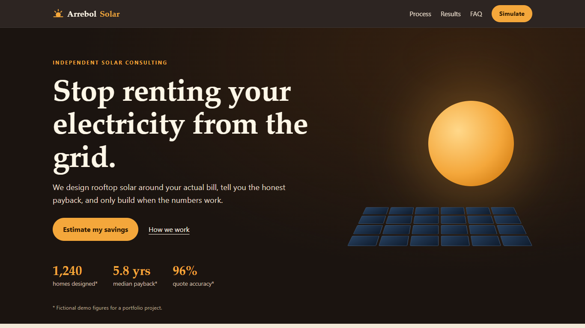
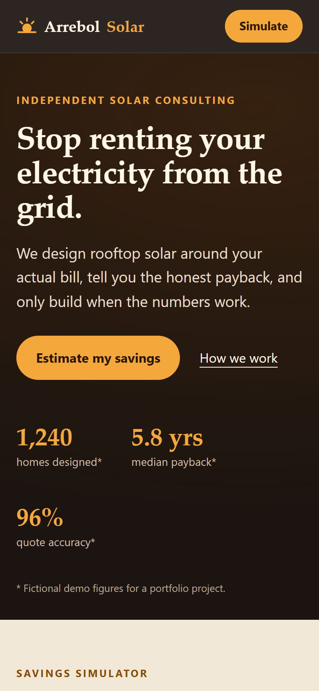

# Arrebol Solar

Landing page for a **fictional** solar energy consultancy, with an interactive savings simulator. Portfolio demo: brand, people, prices and figures are made up.




## What it does
- Simulator: monthly bill, region and roof type produce system size (kWp, panels), investment, first-year savings, payback, 25-year net result and CO2 avoided.
- 25-year cash-flow chart in plain SVG with the break-even point marked.
- Demo lead form (validated, nothing is stored or sent), process, sample projects and FAQ.
- Responsive down to 390 px, keyboard accessible, reduced-motion aware.

## Model (all assumptions are illustrative)
Consumption = bill / regional tariff; the 100 kWh grid availability fee stays billed. Generation per kWp = sun-hours x 30 x 0.80. Cost = kWp x R$ 6,200 x roof factor. Savings grow with a 5%/yr tariff rise and 0.7%/yr panel degradation. See `src/calc.ts`.

## Stack
Vite + Preact + TypeScript, Vitest. No UI library, no runtime dependency beyond Preact (~24 kB JS).

```bash
npm ci
npm test
npm run dev
npm run build
```

CI (`.github/workflows/pages.yml`) runs tests and the build on every push, then deploys `dist` to GitHub Pages from `main`.

## License
MIT
